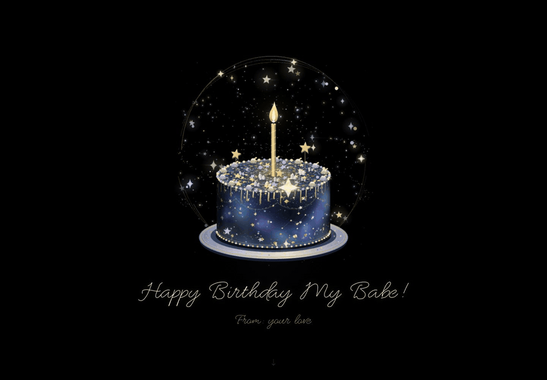
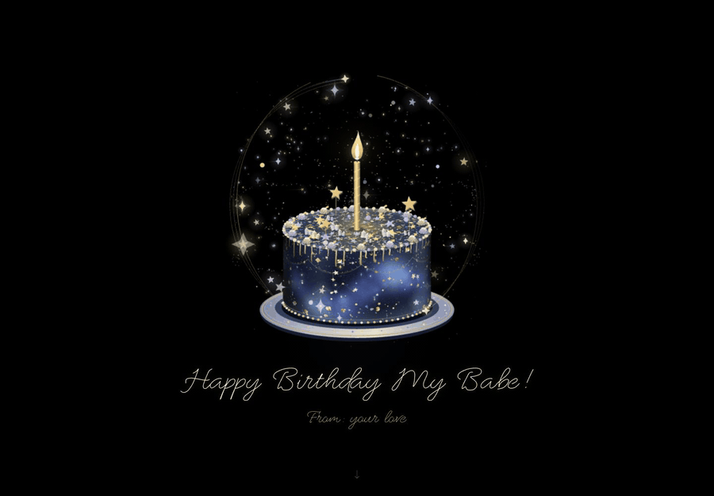

# Birthday Webpage

[English](README.md)

一盏烛光，一片星空，一封值得珍藏的信。

Birthday Webpage 是一个可直接部署的生日祝福网页：缓缓转动的星空蛋糕、逐笔写出的祝福，以及随滚动展开的信件，在纯黑背景上共同呈现一份心意。它可以直接成为一场完整的生日庆祝，也可以作为创作专属祝福的模板；所有祝福与信件文字都能替换，布局和动画会随新内容自动适配。

## 让生日祝福成为特别的时刻

- **烛光旁的一整个小宇宙。** 星云釉面、金箔、糖晶、珍珠滚边与层层裱花，映衬着飞行的星星和柔和光尾。画面由网页实时绘制，持续流动。
- **让文字慢慢抵达。** 祝福与署名沿真实笔画逐渐写出；继续向下滚动，带有纸张纹理的信笺展开，正文一段段浮现。
- **每一块屏幕，都有合适的呈现。** 电脑端，蛋糕移向左侧，信纸在右侧展开；手机端，信件接续在生日画面之后，留出适合阅读的边距。
- **还有一个小小的心愿。** 点击或轻触烛火，就会绽放一簇星光。

页面尊重系统的“减少动态效果”设置；场景离开视野或标签页进入后台后，持续动画会暂停。

## 打开，即可欣赏

1. 下载或克隆此仓库。
2. 在现代电脑浏览器中打开 `index.html`。
3. 欣赏蛋糕与祝福，再向下滚动阅读信件。

本地浏览无需安装、构建或联网。HTML、CSS、JavaScript 与随项目附带的手写笔画数据，即可呈现完整效果。

## 写成自己的心意

所有祝福和信件文字都可以在 [content.js](content.js) 中修改。换上名字、补充一句祝福，或重写整封信，手写路径、文字尺寸与段落入场动画都会随新内容自动适配，无需重新编写动画。

| 配置项 | 修改内容 |
| --- | --- |
| `recipient`、`sender` | 收信人的名字与署名 |
| `greeting`、`punctuation`、`fromLabel` | 主祝福、结尾标点与署名引导文字 |
| `extraWishes` | 主祝福下方的额外寄语 |
| `letterSalutation` | 信件称呼 |
| `letterParagraphs` | 信件正文，每一项对应一个段落 |
| `letterClosing` | 署名前的结语 |
| `animation` | 蛋糕旋转速度、手写时长与星星数量 |

在信件文字中使用 `{recipient}` 和 `{sender}`，即可引用配置中的名字与署名。保存文件，刷新网页，就能看到新的效果。

随项目附带的笔画字体支持英文字母等字符的书写动画；中文等其他文字以正常字体显示，同时保留响应式布局与正文逐段显现的效果。

## 把这份庆祝分享出去

将 `index.html`、`content.js`、`assets/`、`licenses/`、`LICENSE`、`NOTICE` 与 `VERSION` 发布到静态网站托管服务，保留相对目录结构即可。无需配置后端或构建命令，分享生成的网址，电脑和手机都能访问。

## 许可证

本项目采用 **[PolyForm Noncommercial License 1.0.0](LICENSE)**（PolyForm 非商业许可证 1.0.0）授权。

本项目免费提供给所有人用于个人及其他非商业用途。在遵守许可证条款的前提下，你可以自由使用、修改和重新分发本项目。重新分发时须附上本许可证及[版权声明](NOTICE)。

**严禁任何商业用途**，包括但不限于：出售本项目或其修改版本，提供基于本项目的付费定制、代搭建服务，向他人收费托管，以及加入广告投放获利。

本项目不提供任何商业授权。

请尊重本项目的创作初衷：**传递幸福与快乐，而非谋取商业利益。**

*此章节仅为方便理解而提供的摘要，具体授权条款以 `LICENSE` 文件中的完整许可证文本为准。*

## 致谢

蛋糕与星空由 Canvas 绘制，手写效果使用源自 Allura 的 EMS Allure 字体 SVG 笔画。字体作者信息与 SIL Open Font License 收录于 [licenses/EMS-Allure.txt](licenses/EMS-Allure.txt)。
